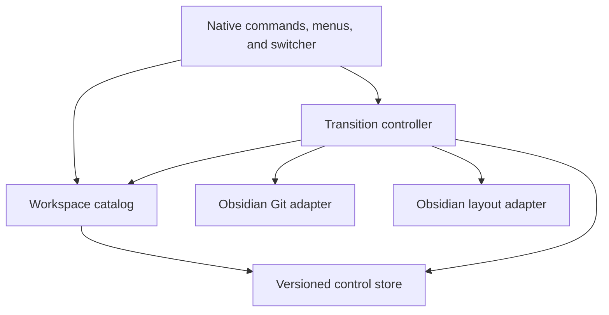
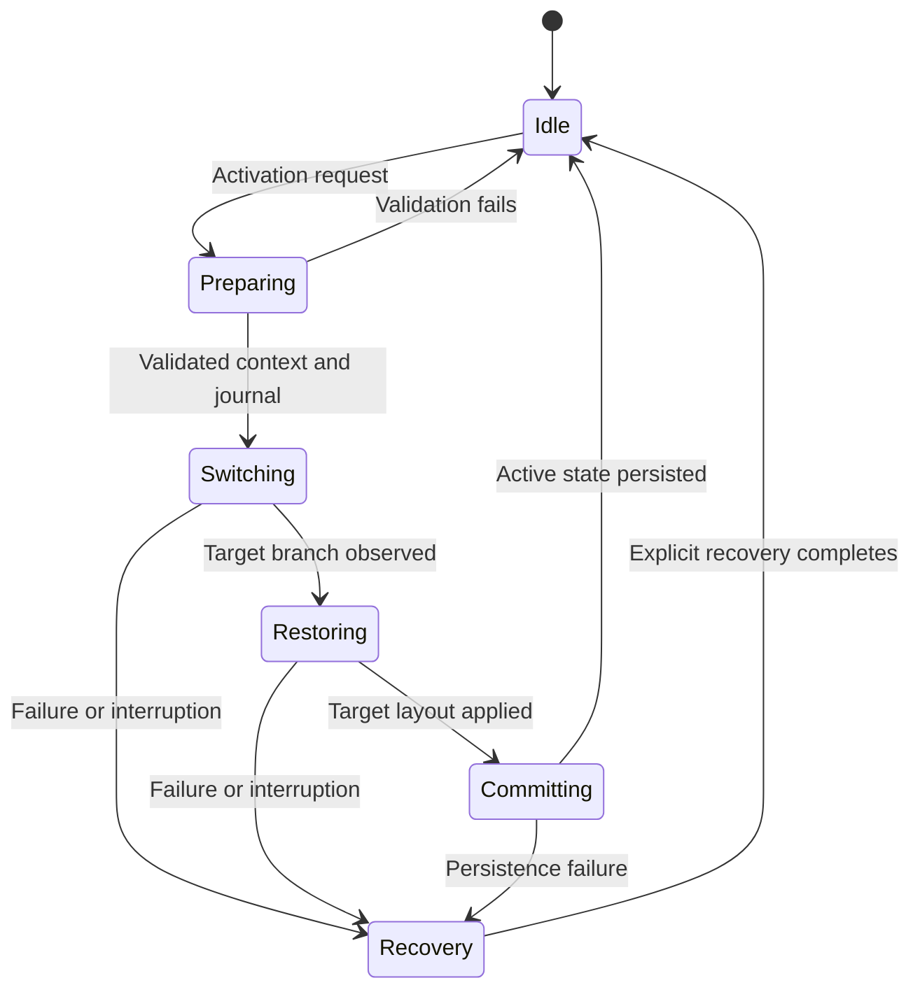

# Architecture

## One catalog, one transition owner

The catalog owns workspace identity, metadata, layouts, groups, and history. The transition controller owns activation. Native UI submits intentions to those components and renders their results. It does not perform Git or layout operations independently.

Native layouts remain opaque Obsidian state wherever possible. The product adds identity and context around them; it does not reconstruct every leaf from a list of files. This preserves pinned tabs, split geometry, view state, and sidebar relationships that belong to a saved layout.

## Implementation map

| Module | Responsibility |
| --- | --- |
| `src/main.ts` | Compose services and register the plugin lifecycle and commands. |
| `src/workspaces/model.ts` | Workspace records, platform-specific context snapshots, state version, and recovery journal. |
| `src/workspaces/catalog.ts` | Identity, creation, rename, duplication, grouping, history, and record queries. |
| `src/workspaces/controller.ts` | Serialized activation, explicit saves/binding changes, persistence, and recovery. |
| `src/storage/store.ts` | Desktop atomic files and mobile plugin-data storage. |
| `src/storage/migrations.ts` | Validate the product schema and convert supported import formats. |
| `src/obsidian/layout.ts` | Capture/restore live layouts and observe target files. |
| `src/obsidian/layout-data.ts`, `clone-json.ts` | Pure layout operations and independent JSON snapshots. |
| `src/git/backend.ts`, `obsidian-git.ts` | Required Git operations and the installed-plugin compatibility adapter. |
| `src/ui/menu.ts`, `switcher.ts`, `settings.ts` | Native presentation and user requests. |

## State boundaries

| State | Owner | Lifetime |
| --- | --- | --- |
| Workspace ID, name, group, presentation | Catalog | Persistent; name changes preserve ID. |
| Branch association and saved layouts | Catalog context | Persistent together; a layout has an interpretable branch context. |
| Desktop/mobile layout slots | Catalog context | Separate slots sharing workspace identity. |
| History | Catalog | Immutable saved contexts with bounded retention. |
| Actual branch and working-tree status | Git backend | Observed at operation boundaries; never inferred from the status indicator. |
| Live Obsidian leaves | Obsidian | Captured/restored through the host adapter. |
| Current operation and capture suppression | Transition controller | In memory while an operation owns activation. |
| Incomplete transition | Journal | Durable until completion or explicit recovery. |

The model exposes explicit fields for supported metadata. New fields require migration, duplication, history, and transfer rules. Independent last-writer-wins merging of branch metadata and layout snapshots is excluded from the initial implementation.

## Storage

Desktop stores `state.json` beneath `<application-data>/obsidian-workspaces/<vault-key>/`. The key is the first 24 hexadecimal characters of SHA-256 over the vault's canonical filesystem path. The catalog, history, and journal are part of that state; `state.json.backup` retains the previous complete file. These files remain outside the repository. Atomic file replacement prevents a partial JSON write from replacing the last complete record.

The application-data base is `~/Library/Application Support` on macOS, `%APPDATA%` on Windows (with the conventional roaming directory as fallback), and `$XDG_DATA_HOME` or `~/.local/share` on Linux. These are local storage locations, not paths to add to the vault.

The path key identifies a local vault location, not a cross-device identity. Moving or renaming the vault path requires explicit export/import to relocate its contexts. No Git credentials are stored with the catalog.

Mobile uses Obsidian plugin data. External tools may transport that data; Workspaces does not implement automatic reconciliation. Export/import is the initial transfer mechanism.

## Activation lifecycle

Preparation records the outgoing layout before checkout can remove files. Capture suppression remains active while Git, vault observation, and layout restoration run. The controller verifies the branch and target file state before restoration; a fixed delay alone is not evidence that the vault is ready.

The journal records enough source/target information to distinguish an aborted request from a checkout that completed without a restored layout. A recovered UI must describe the state actually observed. Startup reads that record and reports it without performing a checkout.

Commands, history restoration, imported-context activation, deletion of the active workspace, and any future frontmatter or custom UI route must use this lifecycle. Passive imports and external file arrival do not activate a branch.

## Compatibility boundaries

The installed Obsidian Git plugin supplies the initial desktop backend. Its `withRepository` adapter scope puts the complete Git-aware transition inside the backend's operation queue, preventing another queued Git operation from running between status validation, checkout, and restoration. The adapter validates its version and required capabilities, observes repository status, and awaits an unambiguous operation result. Compatibility assumptions belong in that adapter and its tests. A same-branch layout switch skips checkout and can retain dirty file state; an actual branch change requires a clean worktree.

The host adapter handles native layout capture/restoration and file observation. Unavoidable private APIs stay isolated; native UI classes do not make every adjacent internal API public.

Core Workspaces is a source format for explicit import. Workspaces owns its live catalog and does not keep a second writable core catalog in step with it. Native presentation and native layout restoration do not require a dependency on the core Workspaces plugin.

## Decisions

1. [Workspace authority and persistence](adr/0001-workspace-authority-and-persistence.md).
2. [Obsidian integration and native interface](adr/0002-obsidian-integration-and-native-interface.md).
3. [Git binding and backend](adr/0003-git-binding-and-backend.md).
4. [Workspace transitions and recovery](adr/0004-workspace-transitions-and-recovery.md).
