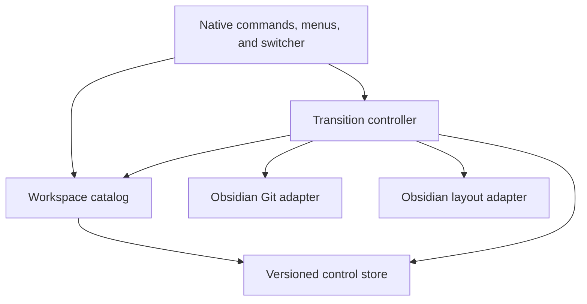
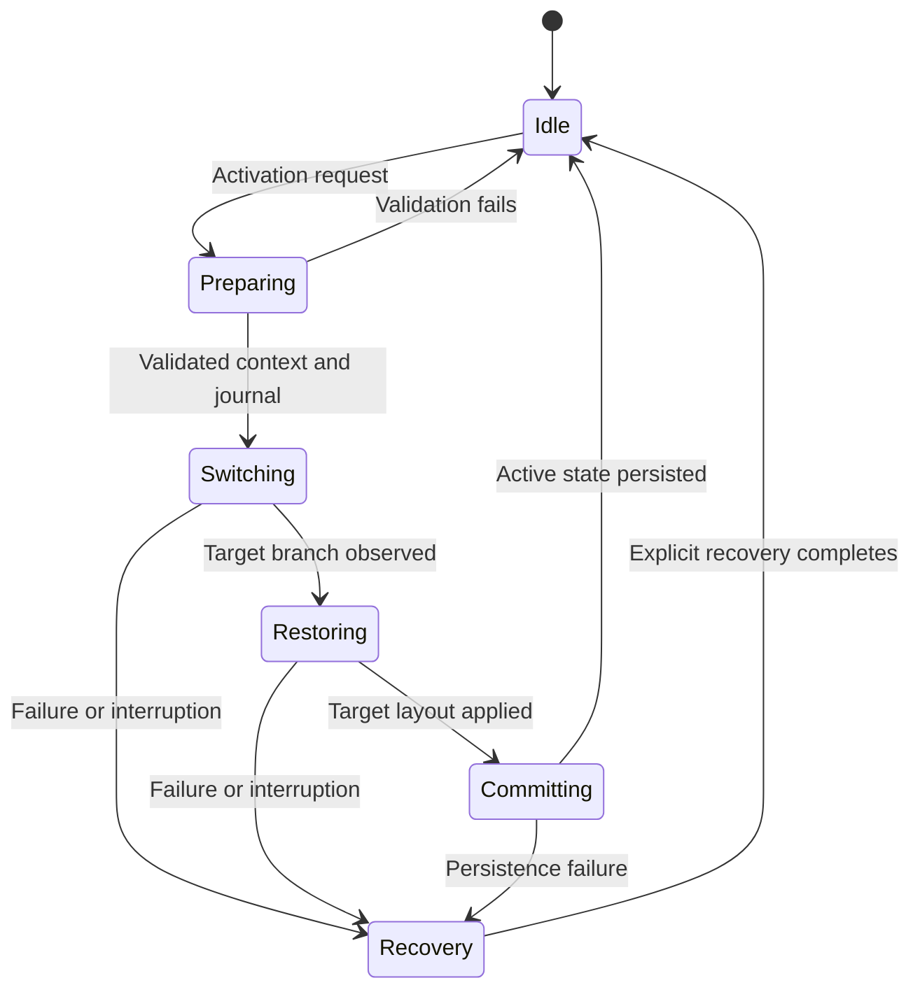

# Architecture

## One catalog, one transition owner

The catalog owns workspace identity, metadata, layouts, groups, and history. The transition controller owns activation. Native UI submits intentions to those components and renders their results. It does not perform Git or layout operations independently.

The core Workspaces list is not a second catalog. While that core plugin is enabled, a bridge projects the catalog into it and sends its operations to the transition controller ([ADR 0006](adr/0006-native-core-catalog-bridge.md)).

Native layouts remain opaque Obsidian state wherever possible. The product adds identity and context around them; it does not reconstruct every leaf from a list of files. This preserves pinned tabs, split geometry, view state, and sidebar relationships that belong to a saved layout.

## Implementation map

| Module                                                       | Responsibility                                                                                                     |
| ------------------------------------------------------------ | ------------------------------------------------------------------------------------------------------------------ |
| `src/main.ts`                                                | Compose services and register the plugin lifecycle and commands.                                                   |
| `src/workspaces/model.ts`                                    | Workspace records, platform-specific context snapshots, state version, and recovery journal.                       |
| `src/workspaces/catalog.ts`                                  | Identity, creation, rename, duplication, grouping, history, and record queries.                                    |
| `src/workspaces/controller.ts`                               | Serialized activation, explicit saves/binding changes, persistence, and recovery.                                  |
| `src/storage/store.ts`                                       | Desktop atomic files and mobile plugin-data storage.                                                               |
| `src/storage/migrations.ts`                                  | Validate the product schema and convert supported import formats.                                                  |
| `src/obsidian/layout.ts`                                     | Capture/restore layouts, flush loaded editors, unload outgoing views, and block interaction during transition.     |
| `src/obsidian/layout-files.ts`                               | Observe file/index/cache readiness and verify restored file leaves and pins.                                       |
| `src/obsidian/vault-reconcile.ts`                            | Optional, version-checked native reconciliation after checkout; full readiness verification remains authoritative. |
| `src/obsidian/layout-data.ts`, `clone-json.ts`               | Pure layout operations and independent JSON snapshots.                                                             |
| `src/obsidian/plugins.ts`                                    | Isolate lookup of the installed Git plugin.                                                                        |
| `src/obsidian/quick-switcher.ts`                             | Route Quick Switcher++ workspace suggestions and its save-and-switch shortcut to the catalog/controller.           |
| `src/obsidian/native-catalog.ts`                             | Core Workspaces bridge: route core methods to the controller, project the catalog, plan reconciliation.            |
| `src/git/backend.ts`, `obsidian-git.ts`                      | Required Git operations and the installed-plugin compatibility adapter.                                            |
| `src/ui/menu.ts`, `switcher.ts`, `settings.ts`, `dialogs.ts` | Native presentation and user requests.                                                                             |

## State boundaries

| State                                   | Owner                 | Lifetime                                                                    |
| --------------------------------------- | --------------------- | --------------------------------------------------------------------------- |
| Workspace ID, name, group, presentation | Catalog               | Persistent; name changes preserve ID.                                       |
| Branch association and saved layouts    | Catalog context       | Persistent together; a layout has an interpretable branch context.          |
| Desktop/mobile layout slots             | Catalog context       | Separate slots sharing workspace identity.                                  |
| History                                 | Catalog               | Immutable saved contexts with bounded retention.                            |
| Actual branch and working-tree status   | Git backend           | Observed at operation boundaries; never inferred from the status indicator. |
| Live Obsidian leaves                    | Obsidian              | Captured/restored through the host adapter.                                 |
| Current operation and mutation queue    | Transition controller | In memory while an operation owns activation.                               |
| Incomplete transition                   | Journal               | Durable until completion or explicit recovery.                              |
| Core Workspaces list                    | Core plugin           | A projection of the catalog while the bridge is attached.                   |
| Core projection baseline                | Catalog state         | Persistent, device-local; names the last confirmed projection.              |

The baseline lags the core file: a record enters it only after its projection was written. Removing a record moves its projected name to a retired list until the next confirmed projection. Migration drops baseline entries for unknown records. Duplication, history, export, and import do not copy the baseline.

The model exposes explicit fields for supported metadata. New fields require migration, duplication, history, and transfer rules. Independent last-writer-wins merging of branch metadata and layout snapshots is excluded from the initial implementation.

## Storage

Desktop stores `state.json` beneath `<application-data>/obsidian-workspaces/<vault-key>/`. The key is the first 24 hexadecimal characters of SHA-256 over the vault's canonical filesystem path, resolved through `realpath`. The catalog, history, and journal are part of that state; `state.json.backup` retains the previous complete file. Before Git-aware operations, the store checks its resolved directory against the repository root and rejects an application-data location inside that repository.

The application-data base is `~/Library/Application Support` on macOS, `%APPDATA%` on Windows (with the conventional roaming directory as fallback), and `$XDG_DATA_HOME` or `~/.local/share` on Linux. These are local storage locations, not paths to add to the vault.

Each write creates `state.json.lock` exclusively and checks the expected persisted revision. It writes and syncs a temporary file, copies the previous primary to `.backup`, atomically renames the temporary file, then syncs the directory where supported. A write conflict requires reloading Workspaces; the store does not merge competing instances. The lock is removed after writing. If a process interruption leaves it behind, close every instance using that vault before manually removing the reported lock path. The plugin never expires or steals a lock based on its age.

Invalid primary data fails loading without replacing it or silently loading the backup. The backup is available for explicit recovery with the plugin closed. A write that replaced the primary but could not confirm directory durability is reported as such, keeping the controller aligned with the replaced state rather than pretending no write occurred.

The path key identifies a local vault location, not a cross-device identity. Moving or renaming the vault path requires explicit export/import to relocate its contexts. No Git credentials are stored with the catalog.

Mobile uses Obsidian plugin data, as does a desktop vault without a filesystem adapter. Git binding requires the external desktop store. External tools may transport plugin data; Workspaces does not implement automatic reconciliation. Export/import is the initial transfer mechanism.

## Activation lifecycle

Preparation records the outgoing layout before checkout can remove files. All mutations use the controller queue; this version has no periodic, layout-change, rename, or delete handler that rewrites saved snapshots. User interaction is blocked during the transition. The controller awaits saves of loaded text editors. A deferred view has no buffer, so the flush does not load it. Before a checkout the host loads every deferred view, checks that each view is supported, and unloads outgoing file views. The controller revalidates Git status after unloading because unloading may save again.

A switch with no checkout has an unbound target, or a bound target whose branch is already checked out. No file changes in such a switch. The controller then calls neither the readiness wait nor the hydration: the host awaits native `changeLayout`, verifies the file leaves, and Obsidian loads a hidden view when it is shown. The two durable writes, the input guard, and the journal are the same for both kinds of switch. Recovery follows the same rule: it waits and hydrates only when it checked out the original branch.

The adapter's checkout method owns that final revalidation; the controller does not run an identical guard immediately before it. Input protection is immediate and has no visible surface of its own. Progress is a message in the Workspaces status bar item, shown through a callback that the host receives from the plugin entry point; the host creates no modal. The item uses the `mod-loading` class and the `progress-bar-indicator` markup that Obsidian 1.15 uses for its own start-up progress. Obsidian has no public API for that indicator, so this is styling by core class names: if a later version drops them, the message remains as plain text.

The input guard captures editing and activation events across the main document and floating windows. A temporary public `window-open` subscription protects popouts created during restoration; release removes the subscription and all guards.

After a checkout, file readiness checks require the target paths in both the filesystem and vault index, matching file metadata, and current cached text for supported text paths. Removed source files must also leave the index. A target path that is absent from disk is not a requirement once the index has dropped it. Restoration verifies file references, view types, regions, and pin flags against the requested snapshot on every switch. It reads the native layout, which includes deferred leaves. Before `changeLayout` the host reads from the vault index which saved notes no longer exist. Verification ignores their leaves on both sides, and one notice names them after the restore. Backlinks, Outgoing links, Outline, Local graph, and File properties follow the active file. Obsidian saves them with or without a file and resolves the file again after restore, so their saved path is neither a readiness requirement nor a restored note. Native layout restoration owns these panes like any other panel. A timeout reports failure; elapsed time alone never establishes readiness.

On the inspected desktop Obsidian 1.15.1 filesystem adapter, an optional queued native reconciliation of relevant paths avoids the watcher's 100 ms deletion-confirmation delay after checkout. Unsupported versions/adapters fall back to the existing observer/probe path. Reconciliation never substitutes for the readiness checks. After a checkout, native layout reconstruction completes before remaining deferred views hydrate concurrently; all started operations settle before the controller can release ownership.

Readiness subscribes before probing. Relevant vault events wake the next full pass, including events received during an awaited probe; a revision counter prevents lost notifications or acceptance of a pass invalidated midway. The 100 ms fallback remains bounded by the remaining timeout. Listeners and timers are removed on every exit.

The journal records enough source/target information to distinguish an aborted request from a checkout that completed without a restored layout. A recovered UI must describe the state actually observed. Startup reads that record and reports it without performing a checkout.

Only preparation and successful completion require durable writes on the normal path. Intermediate checkout/restoring phases are emitted in memory at the prepared revision. The prepared record contains the entire recovery context and remains on disk until completion; its phase does not prove whether checkout ran. Recovery observes the actual repository before acting. Atomic replacement, fsync, backups, locking, and revision checks remain unchanged.

Commands, history restoration, imported-context activation, deletion of the active workspace, core Workspaces requests, and any future frontmatter or custom UI route must use this lifecycle. Passive imports and external file arrival do not activate a branch.

## Compatibility boundaries

The installed Obsidian Git plugin supplies the initial desktop backend. Workspaces' `withRepository` adapter scope puts the complete Git-aware transition inside that plugin's internal operation queue, preventing another queued Git operation from running between status validation, checkout, and restoration. This is a capability-checked internal integration, not a published Obsidian Git API. The adapter accepts 2.43.x and targets the inspected 2.43.0 contracts. It observes repository status and awaits an unambiguous operation result. A same-branch layout switch skips checkout and can retain dirty file state; an actual branch change requires a clean worktree. External Git processes are outside this queue.

The host adapter handles native layout capture/restoration and file observation. It awaits `TextFileView.save()` and supports native media views and the built-in Backlinks, Outgoing links, and Outline panes when unloading; other editable views require closing before branch checkout. Node filesystem modules are loaded only inside desktop operations, so unbound mobile use does not resolve them at module load. Unavoidable private APIs stay isolated; native UI classes do not make every adjacent internal API public.

Core Workspaces is a source format for explicit import and, while it is enabled, a second view of the same catalog. Workspaces owns the only writable catalog. Native presentation and native layout restoration do not require a dependency on the core Workspaces plugin.

The core catalog bridge targets the core Workspaces instance inspected on Obsidian 1.15.1. It requires `saveWorkspace`, `setActiveWorkspace`, `loadWorkspace`, `deleteWorkspace`, and `saveData` as functions and `workspaces` as an object; otherwise it shows one notice and changes nothing. It replaces the four catalog methods on the instance, keeps their descriptors, and restores them only when they are still its own wrappers. `saveData` stays the core method and is the only writer of `workspaces.json`.

A routed load, delete, or save is one controller operation. The bridge never calls `changeLayout`. Core calls `saveWorkspace` synchronously, so the bridge shows an optimistic in-memory entry and corrects it when the operation settles. Requests from core run in order. The promises that core awaits settle after the commit and the next projection, and they do not reject; errors appear as notices.

The controller notifies inside its transaction, so the bridge's listener only starts a timer. A projection runs when the controller is idle, compares the serialized list with the content known to be on disk, and writes only a difference. After a confirmed write it records the baseline through `confirmNativeProjection` when names changed. An ordinary switch changes the active name in the core file and never the baseline.

Reconciliation runs once per attach, before the first projection: `planReconciliation` is a pure function and `reconcileNativeCatalog` applies its plan in one commit without activation, layout change, or Git call. It waits for recovery. The bridge attaches and detaches on the `change` event of `app.internalPlugins`; without that event it checks on controller notifications and when the product interface opens.

Quick Switcher++ 6.3.x uses the product catalog through an optional handler adapter, tested with 6.3.0. Suggestions carry stable IDs and an adapter-generation marker; same-name core suggestions cannot accidentally activate a product record. The adapter replaces only workspace-mode methods and their static provider resolver. It wraps the community plugin manager's load/unload methods and observes its `changed` event. That completion event also discovers enables already in progress when Workspaces starts, before the provider instance or its command definitions are ready. Existing workspace modals close when the provider changes. Teardown removes the event subscription and restores the original descriptors only when those methods still belong to this adapter.

Quick Switcher++ calls its save-and-switch provider synchronously. A fresh facade captures that request's source identity and save intent, then submits `saveAndActivate` as one controller queue operation. It never launches an independent save followed by an uncoordinated activation. A source changed by an earlier queued operation, a failed save, or a stale provider stops the request. The native core workspace catalog is neither written nor patched by this adapter. The status indicator renders the workspace name; Obsidian Git remains responsible for the live branch label.

Imports convert source metadata into the product schema. Multiple Workspace++ groups become one label; Workspaces Plus Modes and global configuration overrides are excluded. Platform fallback applies an unbound layout's main area over current platform sidebars, then creates the missing platform slot. Ordinary activation of an existing slot restores its full saved layout.

## Decisions

1. [Workspace authority and persistence](adr/0001-workspace-authority-and-persistence.md).
2. [Obsidian integration and native interface](adr/0002-obsidian-integration-and-native-interface.md).
3. [Git binding and backend](adr/0003-git-binding-and-backend.md).
4. [Workspace transitions and recovery](adr/0004-workspace-transitions-and-recovery.md).
5. [Performance measurement and closure](adr/0005-performance-measurement-and-closure.md).
6. [Native core catalog bridge](adr/0006-native-core-catalog-bridge.md).
