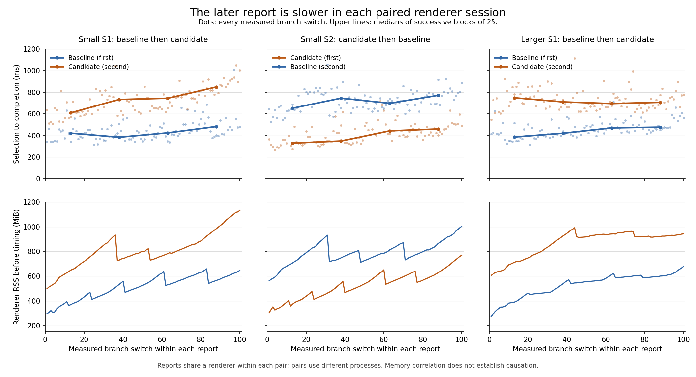

# Workspace switching: native completion measurements

**Date:** 2026-11-15 UTC. **Implementation:** [PR #5](https://github.com/jjjjguevara/obsidian-workspaces/pull/5). **Performance acceptance:** [issue #4](https://github.com/jjjjguevara/obsidian-workspaces/issues/4), open.

## Decision

**Near-instant, consistently modal-free switching is not achieved.** The candidate's fresh small-fixture run measured 404.629 ms median and 594.413 ms p95, with progress in 10 of 100 measured branch switches. Running either build second in an older renderer produced substantially slower results. These measurements do not establish a consistent end-to-end speedup.

The adopted production optimization removes one redundant Git identity query, reducing the ordinary branch path from 20 to 19 raw Git calls. All six long runs passed their 900 exact completion observations and subsequent native verification. The new framework, stricter evidence checks and local Mac closure contract make that limited result reproducible without treating it as performance acceptance.

Issue #4 remains open. Actual Mac measurements are pending, and these Linux results already exceed the defined budgets. The independent review records merge readiness for this partial implementation separately from the unmet performance objective.

## Product change and retained safeguards

The post-flush checkout safeguard already observes a fresh repository root and branch. `prepareSwitch()` returns that identity to the controller, which reuses it for a known bound transition between different branches of the same repository. This removes the immediately redundant post-flush `inspectIdentity()` call.

The source-binding check before editor flushing remains. So do the complete safeguard after view unload, canonical-root and target-ref checks, dirty/conflict/ignored-file/runtime-file protections, provider queue, post-checkout and post-restore identity checks, and both durable state writes. Same-branch and unbound activation keep their original behavior, including pending edits when no checkout is needed. Git execution continues through the **installed Obsidian Git plugin**.

In the measured samples, baseline raw Git counts were normally 20 and candidate counts 19. Periodic provider refresh added two calls in some samples; those observations remain included. This is a verified reduction in work, not a measured guarantee about subprocess or wall-clock savings.

## Measurement and build identities

The long comparison used one identical benchmark bundle for both product builds. A subsequent report-output hardening change modified the bundled benchmark bytes because it imports the safety probe, even though normal benchmarking overrides that probe's writer. The two identities remain separate below; no historical report was relabeled.

| Artifact | Source / SHA-256 |
| --- | --- |
| Baseline product source | `6b3ae45589132a7c37da14e94a20a4668b2f28b9` |
| Baseline `main.js` | `9dee2cbb8b25f768f81d3b94ec1a7c57ddae55267ae29de459ad00a8d94d3400` |
| Measured candidate product source | `d7399c2dd7b642e4e2c904bb55a02ad38039a67d` |
| Candidate `main.js`, unchanged by later probe hardening | `f4a862e7fd3c90786e4474a1e7c4a0041cc9d73d8595cda448cf64b10d530020` |
| Long-comparison benchmark | `394466fd2c824d4f2f49a46f1b7848c91303f27ccf77cdf03a34233bddf80431` |
| Long-comparison small safety probe | `14f3396a0d4307d83c33e3ec4bcf4aaecc267868c5aaa57821456f08204d84da` |
| Final product/protocol source for local reproduction | `3f0c0ed8df50efb1fb29b6bf402ad1084b2e9939` |
| Hardened benchmark | `375711885e013bd1a0bc8acb48fe4e77c3d75ff87d03c821556d2d6cfe516792` |
| Hardened safety probe | `312307db21297eb859580186123c1f6f03ad02a280f7c449adf4f0f89cfaf652` |
| Installed Obsidian Git `main.js` | `58beb0981875c672fc83350e3b1f20db6ca1df3ca2047a25f49190b1e31e2443` |
| Installed Quick Switcher++ `main.js` | `6746dad3d6b132698b04c2a10ea0c2f71c03c8b5af7bec753ca76319c72e3f23` |

The independent long runs record clean protocol source `026efdb60c6862f091dd2e382589e881a50875bf`. Its benchmark inputs are included in published `d7399c2…`. Publishing through GitHub's Git-data API generated different commit metadata from the local commits; the published source trees were checked for exact equality. Published `d7399c2…` has tree `e11e82994963470a720733dec935e23fc32be015`; the output-hardening source `2d5fee0…` has tree `f6b4d34892a63d3792dc951ff0de1cfaf4535b08`. The final offline journal verifier is published in `3f0c0ed8df50efb1fb29b6bf402ad1084b2e9939`, tree `3d17bfaf840ecaabc0cfc6416fe8a6b8db151d82`; it leaves all product/probe hashes unchanged.

### Completion boundary

The probe invokes installed Quick Switcher++'s Workspaces command and actual chooser Enter method. It preserves the original `controller.activate()` promise. Its first settlement observer synchronously copies and freezes layout, file/editor contents, pins, active identifiers, deferred flags, recovery journal, status indicators and input release **before any await, frame wait, Git/file read or repair**.

An independent validator checks this immutable endpoint against the target layout and expected branch bytes. Later Git, disk, index and live-editor checks are separate native verification. They cannot repair an incorrect completion observation. Primary latency is selection to original controller-promise settlement, including repository-scope completion. Input release, capture overhead, first switch and next rendering opportunity are separate measurements. A frame callback does not establish physical display scanout.

Before timing, native disable/enable reloads the product and verifies new plugin, controller and constructor identities, stable installed bytes and preserved providers/source context. This is procedural provenance, not cryptographic attestation of arbitrary runtime memory. First-switch measurements are probe-cold, not OS-cache-cold.

## Environment and workload

Actual desktop **Obsidian 1.15.1**, **Obsidian Git 2.43.0**, and **Quick Switcher++ 6.3.0** ran on Linux 6.18.57, x64, eight exposed AMD EPYC 9V74 CPUs and approximately 10 GB RAM. The inspected Electron runtime was 43.8.9, Node 24.22.1 and Chrome 150.0.7871.250. The viewport was 1024 × 800 at device-pixel ratio 1.

| Profile | Tracked files per branch | Changed paths | Generated notes | Markdown editors |
| --- | ---: | ---: | --- | ---: |
| Small | 4 | 5 | None | 4 |
| Larger synthetic | 1,054 | 105 | 1,000 unchanged plus 50 unique to each branch; 4 KiB each | 4 |

Both fixtures include branch-exclusive pinned main notes and both sidebar pins, plus a shared path whose equal-length content differs between branches. They have no remote repositories or personal note contents. The larger fixture is a declared synthetic Linux scope, not a claim about the user's normal vault. The two profiles are independently created native layouts; cross-profile latency differences cannot be attributed solely to file volume.

Each report contains 100 measured alternating branch switches, 20 same-branch controls, 20 unbound controls, plus first-switch/warmup/cleanup observations: **150 samples**. Two paired small sessions reverse build order; one larger pair uses baseline first. Each pair shares a native session and renderer; independent pairs use different processes.

| Pair | Renderer PID | Native session UUID | Order |
| --- | ---: | --- | --- |
| Small S1 | 11744 | `407aa8a8-1a25-4a51-9e1a-cf8a55d0f1e8` | Baseline → candidate |
| Small S2 | 17153 | `78d776c0-704d-4ad0-90da-c57cb2f28aa4` | Candidate → baseline |
| Larger S1 | 22217 | `a40e941f-7e32-431a-b8ec-72865fd92b1d` | Baseline → candidate |

No builds, tests or bulk evidence processing overlapped the long timings. The reviewer observed desktop idle blanking after Small S2 completed. For each larger run, one outside-app pointer movement without clicking or typing kept the display awake, approximately 45 and 48 seconds after starting. Every recorded sample passed the document/native focus and native Settings checks. Settings, theme, provider configuration and visual topology were operator-maintained conditions; the gate does not claim to capture every such setting.

## Measured performance

Times are milliseconds. Each branch row contains 100 measured switches; modal counts include both the branch subset and the whole 150-sample report. Percentiles use nearest rank; even-sized medians use the middle-value midpoint.

| Profile / order | Build | Median | p95 | p99 | Min–max | Branch modals / 100 | All modals / 150 |
| --- | --- | ---: | ---: | ---: | ---: | ---: | ---: |
| Small S1, first | Baseline | 425.918 | 624.671 | 687.968 | 316.258–1,007.749 | 15 | 15 |
| Small S1, second | Candidate | 733.679 | 921.255 | 1,037.779 | 507.513–1,048.526 | 95 | 100 |
| Small S2, first | Candidate | 404.629 | 594.413 | 684.330 | 265.957–717.819 | 10 | 10 |
| Small S2, second | Baseline | 714.492 | 866.545 | 923.102 | 527.579–1,053.153 | 98 | 102 |
| Larger S1, first | Baseline | 453.471 | 581.893 | 657.948 | 317.373–709.583 | 17 | 18 |
| Larger S1, second | Candidate | 712.359 | 896.162 | 993.834 | 546.674–1,116.164 | 100 | 102 |

The balanced small-profile pool contains 200 measured branch switches per build: baseline median/p95/p99 **593.445 / 841.040 / 923.102 ms**, candidate **575.511 / 899.184 / 1,000.581 ms**. Candidate median is lower but its tails are higher, and neither candidate session meets the budget. Pooling does not remove the observed session effect or establish a repeatable improvement.



The figure shows every measured branch sample and successive 25-sample medians. Its x-axis is sample order within each report, not shared elapsed time. [plot.py](plot.py) reproduces it from the archived reports with Matplotlib.

### Controls, first switch and rendering opportunity

Control cells contain median / p95 / p99. Every control cell has 20 measured observations. The first-switch column is separate from the measured distribution; its modal state is included.

| Report | Same-branch controls | Unbound controls | First switch; modal | Branch next-frame median / p95 |
| --- | ---: | ---: | --- | ---: |
| Small S1 baseline | 235.499 / 353.565 / 377.480 | 194.341 / 282.610 / 369.357 | 420.265; no | 429.399 / 629.161 |
| Small S1 candidate | 261.248 / 567.874 / 583.553 | 231.539 / 265.344 / 333.492 | 629.194; yes | 737.643 / 924.639 |
| Small S2 candidate | 239.177 / 393.683 / 430.521 | 203.140 / 238.221 / 277.162 | 418.068; no | 408.209 / 597.742 |
| Small S2 baseline | 251.077 / 428.134 / 430.618 | 212.532 / 246.183 / 625.629 | 669.355; yes | 718.722 / 870.674 |
| Larger baseline | 182.625 / 211.521 / 257.541 | 104.526 / 120.536 / 165.876 | 402.565; no | 458.266 / 587.451 |
| Larger candidate | 208.165 / 232.766 / 290.181 | 113.878 / 126.541 / 151.027 | 636.085; yes | 721.860 / 902.550 |

The complete [summary](summary.json) preserves both directions, input release, all ranges, first-switch frame timing, per-session and pooled controls. An unbound Small S2 candidate observation captured its endpoint in 105.944 ms; this outlier remains included in the next-frame evidence and is not subtracted from any result.

## Attribution and remaining work

The [component analysis](component-analysis.json) treats nested safeguard spans and presentation overlap explicitly. These are distributions of components; their medians must not be added to manufacture an end-to-end total.

| Component median | Small baseline, first | Small candidate, first | Small baseline, second | Small candidate, second |
| --- | ---: | ---: | ---: | ---: |
| Repository identity outside guards | 61.467 | 47.617 | 110.784 | 90.197 |
| Checkout safeguards | 124.362 | 125.057 | 267.421 | 287.047 |
| Native Git checkout | 12.578 | 11.432 | 24.861 | 25.779 |
| Vault readiness | 52.882 | 52.004 | 110.914 | 111.631 |
| Native layout restore | 69.770 | 66.649 | 73.010 | 73.745 |
| Durable state writes | 28.775 | 28.217 | 28.071 | 27.673 |
| Git presentation outside other stages | 14.391 | 13.959 | 27.114 | 27.810 |

The independent audit measures the union of raw Git promise intervals rather than double-counting concurrent reads. Its medians are 236.414 and 226.638 ms for the two fresh small runs, then 494.641 and 498.699 ms for the later runs. In the larger pair, this interval grows from 230.499 to 449.794 ms while native restore stays at 87.100 and 86.016 ms. Observed provider queue-wait medians are about 0.008–0.010 ms. The growth appears in returned Git-operation waits, not in a long wait to acquire that queue.

Renderer RSS also grows during each run. First-to-last measured branch observations were 297→646 MiB and 499→1,134 MiB in Small S1; 304→769 MiB and 562→1,003 MiB in Small S2; 273→679 MiB and 606→942 MiB in the larger pair. This correlation does not establish a native memory leak, GC cause, process-creation cause or the observer's causal share. Those distinctions require separate diagnostics. No artificial settling sleeps or forced garbage collection were used to make timing pass.

Reaching the budget still requires reducing native Git/readiness costs and explaining their session-dependent growth. Non-Git work also matters: the larger unbound candidate median is 113.878 ms with no ordinary Git calls, and its native-restore median is 79.205 ms. Removing one more identity query or delaying the progress display cannot establish the full objective. The production progress delay remains **500 ms**.

### Experiments retained separately

The earlier recorder rewrote the entire growing report after every sample. A final 150-sample report was about 10.4 MB, with at least 381 MB of compact cumulative serialization; pretty-printed output was larger. Earlier inter-sample gaps grew substantially. Those reports lacked memory observations and cannot quantify the observer's causal contribution. They are retained in [superseded evidence](superseded/) and are ineligible for closure.

The replacement recorder appends each immutable raw sample once, retains compact statistics, writes small progress records, and streams the final report after timing. In the long comparisons, median sample serialization was 0.224–0.267 ms and median append was 0.250–0.292 ms, outside the switch timer. This removes the proven quadratic recording work; it does not prove zero subsequent scheduling, allocation or filesystem effects. Original JSON and complete NDJSON journals are preserved with both raw and compressed hashes.

Native review also found that `Reload app` can retain the renderer PID, and that a separate Settings popout can escape main-document-only checks. The current protocol requires independent process IDs and native focus/Settings observations. Superseded runs include the inadequate Settings observation, one unfocused first sample and an untracked dependency symlink; those are not edited into acceptable evidence.

An incremental native layout experiment was implemented, corrected for two native lifecycle cases, then removed because normal screening did not establish a benefit. The final product uses the original native `changeLayout` restoration. See the [experiment record](../../performance/native-restore-experiment.md) and preserved source commit `2765b58ff1b9698b94e24102e2893eeadc400fbc`. Its screening numbers predate the corrected recorder and are not final timing evidence.

## Correctness, final protocol and independent review

The reviewer independently revalidated all **900** long-run endpoints, original controller identities/timestamps, native branch/workspace state, recorder and journal digests, ordered attempts, fresh loaded-product provenance, clean source context, focus/Settings observations, and final clean Alpha/null-journal state. The ten-scenario small safety run in Small S1 also passed. The [independent review](review/README.md) records exact observations and its final verdict.

The later protocol hardening gives runtime/safety reports and deep diagnostic checkpoints exclusive random temporary files and atomic publication. The offline gate also compares each pair's source and target file-leaf multisets, preserving multiplicity, ownership region, type and pin state while ignoring generated IDs. Full split topology, stylesheet/configuration equality and workload suitability remain explicit operator/reviewer responsibilities.

Independent review then reproduced a gate false pass with twelve synthetic reports and no journal files. The final offline fix requires a portable journal path and file hash for every report, reads and hashes the actual raw or gzip journal, validates the complete ordered record sequence, and reconstructs every sample/observation and sealed final metadata against the finalized JSON. A syntactically valid hash field alone no longer qualifies. The [synthetic counterexample](review/missing-journal-counterexample.md) is preserved separately and is never counted as Mac evidence.

These hardening changes leave the production bundle and normal measurement boundary unchanged. The reviewer checked that normal benchmarking overrides the inherited safety writer and does not invoke it. The six long reports therefore remain valid, explicitly identified measurements of the unchanged product using probe `394466fd…`; they do not certify timings for probe `37571188…` and cannot become final Mac closure evidence. Hardened native smoke/safety and deliberate failure attempts are preserved separately in the evidence index and review.

| Hardened protocol check | Result | Raw evidence |
| --- | --- | --- |
| Larger native smoke | 34/34 exact completion observations passed; clean Alpha | [Report](hardened-protocol/hardened-scale-smoke.json.gz) |
| Small native smoke | 34/34 exact completion observations passed; clean Alpha | [Report](hardened-protocol/hardened-small-smoke.json.gz) |
| Larger Quick Switcher++ safety | All ten scenarios passed | [Report](hardened-protocol/hardened-scale-safety.json.gz) |
| Small Quick Switcher++ safety | All ten scenarios passed | [Report](hardened-protocol/hardened-small-safety.json.gz) |
| Settings open in a separate native window | Refused before selection; no controller activation; branch, workspace, revision and journal unchanged | [Deliberate failed report](failed-attempts/hardened-native-settings-open.json.gz) |
| First attempt to arrange the Settings test | Initial readiness refused an incorrectly focused empty leaf; zero sample starts | [Preserved failed setup](failed-attempts/hardened-native-settings-rejection.json.gz) |

The Settings rejection records document visibility, document focus and native focus as true. Both legacy Settings booleans were false, while the inspected native host reported an open, connected popout outside the main document. This exercises the exact gap found in independent review. The initial setup failure is not counted as a successful Settings test.

The hardened small checks use a new renderer/session (PID 30157), separate from the long small timing sessions. The larger hardened checks share PID 22217 with that larger comparison. Neither short smoke run is substituted for a required 100-switch acceptance report. Safety covers actual Q++ Enter in both directions, save-and-switch, core Workspaces disabled, duplicate names with stable IDs, workspace-only status text, dirty-editor rejection and subsequent clean recovery. Both fixtures finish with the candidate installed, test probes disabled and clean Alpha active.

Final source `3f0c0ed…` passed type checking, **396 tests with zero failures**, and the shipping build in [GitHub Actions](https://github.com/jjjjguevara/obsidian-workspaces/actions/runs/43767863039/job/132976909097); the [final source job log](ci-3f0c0ed.log) is retained. The independent reviewer also exercised focused writer/closure checks, the original missing-journal counterexample and rehashed semantic-corruption cases. Earlier source CI is retained separately in [ci-2d5fee0.log](ci-2d5fee0.log) and [ci-d7399c2.log](ci-d7399c2.log).

## Reproduction and local Mac closure

Follow the [local Mac runbook](../../performance/local-mac-closure.md). It pins source and provider versions, prepares disposable small and representative vaults, reverses build order, requires fresh renderer processes, preserves failed attempts, and specifies physical verification and safety-report timing. It includes a manifest and the executable closure command:

```sh
node scripts/check-switch-performance.mjs /absolute/reports/closure-manifest.json \
  --output /absolute/reports/closure-result.json
```

The Mac gate requires three paired sessions for **each** profile: 12 complete reports, each with 100 measured branch and 20 same-branch plus 20 unbound switches. Every candidate session and pooled profile must meet median ≤100 ms, p95 ≤200 ms and p99 ≤300 ms, with zero progress openings and every completion/next-frame opportunity below 500 ms, including first switch and warmups. Correct endpoints, matching final artifacts, complete journals, profile suitability and fresh ten-case safety evidence are required.

For this Linux record, regenerate the descriptive summary from the repository root:

```sh
python3 docs/validation/native-completion-budget/summarize.py
node scripts/analyze-switch-benchmark.mjs \
  docs/validation/native-completion-budget/reports/final-small-s2-candidate.json.gz
node docs/validation/native-completion-budget/review/independent-394-analysis.mjs \
  --checkout "$PWD" \
  --evidence-dir "$PWD/docs/validation/native-completion-budget"
```

The [evidence index](evidence-index.json) identifies compressed artifacts and the SHA-256 of both their compressed and original bytes. The [closure status](mac-closure-status.json) is **pending**, not a fabricated Darwin gate result. Publish actual Mac raw reports, hashes, manifest, unedited gate output, final performance and independent review before closing issue #4.
